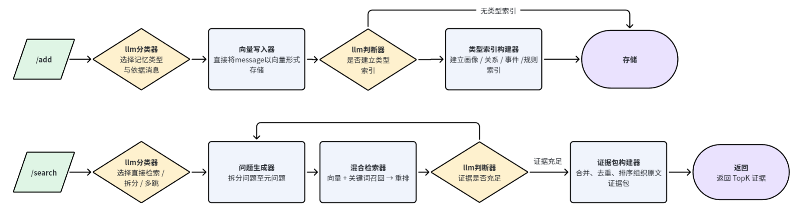

<p align="center">
  
</p>

# GeeMem：Agent 长期记忆与原文证据检索

GeeMem 通过同步 `POST /add` 保存对话，通过 `POST /search` 返回可追溯的原文证据，供上层 Agent 生成回答。服务基于 FastAPI，入口为 `memory.aml_api:app`。

检索器负责召回、选择和组织证据，不生成最终答案，不裁决因果链是否成立或哪个冲突事实有效，也不将模型生成的摘要当成原文返回。

## v1 版本定位

最终 Full 使用的运行代码 commit 为 [`530784a0473cbdae99f40e30953ad8f0f4e6d7a6`](https://github.com/fyuo863/GeeMem/commit/530784a0473cbdae99f40e30953ad8f0f4e6d7a6)。`v1` 是在该运行代码基础上补全文档的发布 tag，不更改检索或写入逻辑。可用 `git rev-parse 'refs/tags/v1^{commit}'` 查询包含最终说明的发布提交；复现时还需使用本节对应的实际配置，tag 本身不包含私有 `.env`。

2026-10-20 核对的部署版本名为 `smoke-newserver-20261019`，部署目录 `/root/CSIG`，由 systemd 管理单 worker Uvicorn 服务。接口为：

| 接口 | 地址 | 鉴权 |
| --- | --- | --- |
| Add | `http://203.189.235.93:18092/add` | Bearer |
| Search | `http://203.189.235.93:18092/search` | Bearer |
| Health | `http://203.189.235.93:18092/health` | 无 |

服务鉴权值通过私有 `.env` 的 `AML_API_KEY` 配置，不等同于平台发放的评测 Key。模型和主要行为配置见下文；时间窗口增强保持关闭。

服务器为 1 vCPU、约 1.8 GiB 内存，无 Swap；检查时磁盘剩余约 22 GB。Add/Search 应用层并发配置均为 0，表示不额外限制准入，不代表无限容量。已完成的文本 Smoke 使用 Add/Search 并发上限各 16，得分 70.58，耗时 21 分 10 秒；这不能替代 Full 规模容量验证，也不代表 Full 成绩。

## 技术组成

| 项目 | 当前值 |
| --- | --- |
| 证据组织 | 原文来源选择、显式关系路径包、来源日期展示 |
| LLM | `gpt-4o-mini`：分类、检索规划与来源选择 |
| Embedding | 百炼 `text-embedding-v4` API，1024维 |
| Reranker | 百炼 `qwen3.7-text-rerank` API |
| 存储 | SQLite，按 `user_id` 隔离 |
| 配置 | 只读取根目录 `.env`，不读取系统环境变量，不执行变量插值 |

运行行为由根目录 `.env` 控制。下文给出当前主流程的配置；`.env.example` 同时包含可选实验项，启用前应核对。密钥不提交 Git。

## 系统架构

GeeMem 将上层检索规划与底层召回分离：上层决定查什么、查哪类以及是否补查；统一底层检索器负责向量与关键词召回、候选合并和重排。最终返回原文证据，由调用方的回答模型完成推理与综合。



| 流程 | 主要步骤 |
| --- | --- |
| `/add` | 分类并选择依据消息 → 保存原文与向量 → 按需建立类型索引 → 发布可检索版本 |
| `/search` | 规划直接、拆分或多跳检索 → 判断目标分区 → 统一召回与重排 → 选择证据并检查缺口 → 有界补查 → 组织原文证据包 |

人物画像、人物关系、事件和规则是同一存储体系中的逻辑分区，共用底层检索器。类型写入器保存分类选中的原文索引，不额外生成事实；未建立类型索引的有效消息仍保存在基础原文与向量库中。

`gpt-4o-mini` 负责分类、规划和证据选择；`text-embedding-v4` 负责向量化；`qwen3.7-text-rerank` 负责重排。程序负责来源绑定、幂等、版本隔离、去重、预算和打包。本地重排适配器和实验模块可通过配置选择，不会自动替换上述模型。

## 接口与鉴权

| 方法 | 路径 | 用途 |
| --- | --- | --- |
| POST | `/add` | 同步写入对话及相关索引 |
| POST | `/search` | 返回排序后的原文证据 |
| GET | `/health` | 无需鉴权的服务存活检查 |

使用下方 Bearer 配置时，Add/Search 请求需携带 `Authorization: Bearer <AML_API_KEY>`。`AML_*` 为现有配置字段名称。

`user_id` 是数据分区键，上游调用方负责将身份正确绑定到对应分区。`session_id` 用于组织来源会话，检索可以跨同一用户的会话进行。

## /add：分类、保存原文与建立索引

1. 验证鉴权、参数和请求幂等性。
2. 分类器选择记忆类型及依据消息；程序绑定来源ID，并为选中消息补充前两条上下文。
3. 向量写入器按消息分块，默认每块320 lexical tokens、重叠40，保存原文、角色、时间、来源位置、可用说话者信息和embedding。
4. 类型写入模块保存人物画像、人物关系、事件、规则等选中原文及索引，不自由生成事实。无须进入类型构建的内容仍保存为向量原文。
5. 完成写入及所需索引后发布可检索版本。失败请求可沿用相同内容和相同 `request_id` 恢复未完成工作。

```http
POST /add
Authorization: Bearer <AML_API_KEY>
Content-Type: application/json
```

```json
{
  "request_id": "write-001",
  "user_id": "user-001",
  "session_id": "session-001",
  "messages": [
    {"role": "user", "content": "Veda has a brother named Niko.", "timestamp": 1704067200000},
    {"role": "user", "content": "Niko takes lessons from teacher Selene.", "timestamp": 1704153600000},
    {"role": "user", "content": "Selene teaches the clarinet.", "timestamp": 1704240000000}
  ]
}
```

成功返回：

```json
{"success": true, "request_id": "write-001", "user_id": "user-001", "session_id": "session-001"}
```

同一用户下，相同 `request_id` 与相同内容重试不会重复写入；相同ID搭配不同内容返回409。单次支持1–200条消息，角色为 `user` 或 `assistant`。

消息 `timestamp` 可省略，提供时为Unix毫秒。扩展字段包括消息的 `speaker` 和请求的 `session_timestamp`。角色不等于人物姓名，系统不会从 `user/assistant` 猜测真实身份，也不能恢复输入中缺失的姓名或时间。

## /search：统一检索与原文证据包

1. 固定本次请求的已发布数据版本，避免多跳过程中混入后来完成的写入。
2. 规划器选择直接检索、独立拆分或依赖式多跳并生成可执行查询；分区判断器为查询选择记忆类型。直接检索使用原问题，不强制拆分。
3. 底层检索器统一执行向量与BM25混合召回，`dual` 分区兼顾目标类型与全局候选，再由Qwen API结合可用上下文重排。
4. 直接问题逐条判断来源，多跳使用增强联合选择；程序保留各轮已选来源。显式JSON关系原文可形成候选路径，保护中间与终点并分路径打包。自然语言原文仍由模型联合选择，不裁决事实有效性。
5. 有可执行补查且预算允许时继续检索；证据充分、无有效补查或预算耗尽时，程序绑定来源、去重、排序和打包，再截取 `top_k` 返回。证据不齐也可返回已有原文，不无限循环。规则适用性及基础脱敏按配置执行。

多跳编排共享查询、调用和时间预算：当前最多6次检索、5次规划/审核LLM调用，每轮最多查看12条证据，每条原文与上下文合计1200字符。独立分区分类等模块的调用不计入该多跳计数，5不是整个请求所有模型调用的绝对上限。

```http
POST /search
Authorization: Bearer <AML_API_KEY>
Content-Type: application/json
```

```json
{"user_id": "user-001", "query": "What instrument does Veda's brother's teacher teach?", "top_k": 10}
```

返回普通原文或原文包。以下仅展示结构，ID与分数为示例：

```json
{
  "data": [
    {
      "id": "bundle_example",
      "content": "[Related original sources; relationships, current validity and event stages are not adjudicated. source_time is message time, not event time.]\n[source_id=\"source-1\"; source_time=\"2024-01-01T00:00:00Z\"]\nVeda has a brother named Niko.\n\n[source_id=\"source-2\"; source_time=\"2024-01-02T00:00:00Z\"]\nNiko takes lessons from teacher Selene.\n\n[source_id=\"source-3\"; source_time=\"2024-01-03T00:00:00Z\"]\nSelene teaches the clarinet.",
      "score": 1.02
    }
  ]
}
```

- `top_k` 必填，范围1–100；可选 `options` 为选择题选项数组，不作为证据。
- 无结果返回 `{"data": []}`；`score` 是排序信号，不是可信概率。
- 每段包含来源ID、消息时间和完整原文；数据库保存包ID到来源ID的映射。
- 普通包最多4段、6000字符；显式候选路径包最多6段、6000字符，可重复引用共享起点。每轮选择仍受12条审查窗口约束。超长单条保留为普通原文，每个包占一个TopK位置。
- 已知消息时间的普通结果也在正文附来源ID与source_time标签，原文正文完整保留。未知/零时间戳不猜测日期，向量与重排输入不受展示标签影响。
- 包不提供整体 `created_at`，因为各段时间不同；普通结果的来源时间未知时也省略该字段。
- 消息时间不等于事件时间，排列顺序不证明因果或事实有效性。证据不完整时也可返回已有原文，不补写缺失事实。

接口接受扩展参数 `reference_time`（Unix毫秒）与 `reference_timezone`。当前时间增强关闭，不能将接受参数解释为启用了时间窗口检索。

## 安装与运行

Python 3.11+，建议使用独立虚拟环境：

```sh
python -m pip install -e ".[rag,test]"
```

首次运行可复制 `.env.example` 为 `.env`，已有文件不要覆盖。以下是当前版本主要配置；供应商URL需匹配实际开通地域或工作空间，密钥自行填写：

```dotenv
MEMORY_BACKEND=vanilla
AML_AUTH_MODE=bearer
AML_API_KEY=<服务鉴权Key>
AML_ADD_CONCURRENCY=0
AML_SEARCH_CONCURRENCY=0
RAG_MEMORY_DB=data/aml/text-embedding-v4.sqlite3

LLM_MODEL=gpt-4o-mini
LLM_BASE_URL=https://api.openai.com/v1
LLM_API_KEY=<OpenAI Key>
LLM_PROXY=

RAG_EMBEDDING_API_URL=https://dashscope.aliyuncs.com/compatible-mode/v1/embeddings
RAG_EMBEDDING_API_MODEL=text-embedding-v4
RAG_EMBEDDING_API_KEY=<百炼Embedding Key>
RAG_EMBEDDING_DIMENSIONS=1024
RAG_EMBEDDING_BATCH_SIZE=10
RAG_EMBEDDING_API_RETRIES=3
RAG_EMBEDDING_RETRY_BUDGET=90
RAG_EMBEDDING_CONNECT_TIMEOUT=10
RAG_EMBEDDING_READ_TIMEOUT=30
RAG_EMBEDDING_RETRY_BACKOFF=1
RAG_EMBEDDING_CONCURRENCY=4
RAG_RERANK_MODE=local
RAG_RERANK_API_PROTOCOL=dashscope
RAG_RERANK_API_URL=https://dashscope.aliyuncs.com/api/v1/services/rerank/text-rerank/text-rerank
RAG_RERANK_API_MODEL=qwen3.7-text-rerank
RAG_RERANK_API_KEY=<百炼Reranker Key>
RAG_RERANK_API_TIMEOUT=60
RAG_RERANK_API_RETRIES=1
RAG_RERANK_SELECTION=direct
RAG_RERANK_CONTEXT=1
RAG_RETRIEVAL_MODE=hybrid
RAG_RESULT_WINDOW=0
RAG_METADATA_MODE=on
RAG_TARGET_MODE=off
RAG_FUSION_QA=off
RAG_TAG_MODE=off

RAG_WRITE_GATE_MODE=on
RAG_BUILD_MODE=on
RAG_PARTITION_MODE=dual
RAG_MULTIHOP_MODE=llm
RAG_MULTIHOP_PROMPT_STYLE=long
RAG_MULTIHOP_RECOVERY=on
RAG_MULTIHOP_ROUNDS=3
RAG_MULTIHOP_QUERIES=6
RAG_MULTIHOP_LLM_CALLS=5
RAG_MULTIHOP_EVIDENCE=12
RAG_MULTIHOP_EVIDENCE_CHARS=1200
RAG_MULTIHOP_BINDINGS=off
RAG_MULTIHOP_NEEDS=off

RAG_EVIDENCE_BUNDLE_MODE=raw
RAG_RAW_SELECTION_MODE=per_source
RAG_RAW_CHAIN_SELECTION_MODE=joint
RAG_VERSION_MODE=on
RAG_DISCLOSURE_MODE=mask
RAG_RULE_APPLICABILITY_MODE=on
RAG_SUPPLEMENTAL_MODE=on
RAG_POSITION_LOG_PATH=data/logs/search-positions.jsonl

RAG_RAW_COVERAGE_MODE=off
RAG_EVIDENCE_GROUP_MODE=off
RAG_EVIDENCE_CHAIN_MODE=off
RAG_FACT_REPLACEMENT_MODE=off
RAG_STATE_EVIDENCE_MODE=off
RAG_SEMANTIC_PRIVACY_MODE=off
RAG_TEMPORAL_MODE=off
RAG_TIME_ANNOTATION_MODE=off
RAG_TEMPORAL_EXPERIMENT=off
```

`RAG_RERANK_MODE=local` 是已有适配器的开关名称；非空API URL使其实际调用HTTP Qwen重排，而不是本地MiniLM。更换embedding需要匹配的新库并重建向量。显式代理填写于 `.env`，不能依赖系统环境变量。

并发配置为0只取消应用层准入限制，不代表数据库或提供商没有容量限制。启动命令：

```sh
python -m uvicorn memory.aml_api:app --host 0.0.0.0 --port 18092 --workers 1 --no-access-log
```

服务启动后可通过 `http://127.0.0.1:18092/health` 检查存活状态。数据库位置由 `RAG_MEMORY_DB` 指定；修改 `.env` 后需要重启服务。

### Embedding 网络容错（v1 后修复）

HTTP Embedding 对连接超时、读取超时、连接中断及 HTTP 408/429/500/502/503/504 进行有界重试。默认每批最多 4 次尝试，共享 90 秒预算（含并发等待、请求和退避），并发上限为每个 Embedder 实例 4 个请求。默认连接/读取超时上限分别为 10/30 秒，实际阶段超时还会按剩余预算缩短；退避从 1 秒起指数增长并加入抖动，单次等待最多 10 秒，支持数值型 `Retry-After`。

仅重试失败的批次，成功批次不重复请求。400/401 等非暂时性错误立即失败，非法响应索引、维度及向量校验仍会拒绝写入。上游请求失败时 Add/Search 返回不含供应商响应或密钥的 HTTP 503，并附 `Retry-After: 5`；不返回虚假的写入成功或空检索结果。请求方应保留相同 `request_id` 和原始载荷重试。该预算按批次计算，不是整个 Add 的总时限；模型、向量身份和原文格式保持一致，不需要重建数据库。`v1` tag 保留原版本，不随此修复移动。

## 日志与诊断

- **位置日志**：`RAG_POSITION_LOG_PATH`，记录来源 ID、排序位置和状态，不记录问题、原文和密钥。
- **详细检索审计**：可配置 `RAG_SEARCH_AUDIT_PATH=data/logs/search-audit.jsonl`，记录问题、每轮审查证据及最终证据包，用于定位漏召回、漏选和未交付的来源。

详细审计包含原文，应限制访问并根据实际需要设置保留周期。多个实例须使用不同日志文件或关闭日志，避免滚动文件竞争。

私有评测数据仅用于对应评测运行，不用于训练或对外共享；运行结束后 30 天内清理相关数据库、详细审计及备份。清理前应确认没有运行中的任务；该保留期限是运维要求，不能据此假定系统已自动定期删除。

## 参考与实现说明

混合检索部分参考了 [wenxiaof345-ctrl/vanilla-rag-memory](https://github.com/wenxiaof345-ctrl/vanilla-rag-memory) 的设计思路，由 GeeMem 独立实现。参考范围为向量召回与 BM25 词法召回结合、候选融合的基础检索流程；项目维护者为 `wenxiaof345-ctrl`，具体原始工作见该仓库 README。

GeeMem 在此基础思路上实现了记忆类型分类与原文索引、统一分区检索、多跳查询规划与来源选择、原文证据包、来源时间展示及写入版本隔离。当前模型、接口及能力边界以本 README 和实际配置为准，不将参考项目的功能或指标作为 GeeMem 的实验结论。

## 能力边界

- 选择器只能看到有限候选，存在漏选；已选来源也可能因包容量或TopK未交付。
- 包内可能混入其他人物、事件的材料，不保证完整或无噪声。
- 新旧事实和事件阶段打包不等于事实替代、完整状态管理或因果推理。
- 基础脱敏不是通用语义隐私或按用途授权系统。
- 尚未提供专门的长历史全局覆盖保障、生成式摘要或无损压缩。
- 显式路径要求原文JSON关系、可匹配的实体及问题中的字面关系名；自然语言、隐式关系、复杂限定不保证完整连接。模型停止标志仍可能不一致。
- 规则适用性模块仍会筛选候选，尚未实现完整规则版本与废止关系管理。
- `/health` 仅证明服务存活，模型可用性需真实Add/Search验证。

## 测试

```sh
python -m pytest -q -p no:cacheprovider
```

真实模型集成测试需要根目录 `.env` 中的有效凭据，并应使用隔离数据库，避免修改业务数据。`tests/` 保存自动化测试，`scripts/` 包含运行与实验脚本。

## 项目结构

| 路径 | 职责 |
| --- | --- |
| `memory/aml_api.py` | HTTP 接口、鉴权和请求响应格式 |
| `memory/vanilla.py` | 装配写入、检索、存储与配置 |
| `memory/write_gate.py` | 记忆类型分类与依据消息选择 |
| `memory/vector_writer.py` | 分块、向量化、原文来源和幂等存储 |
| `memory/route_writer.py` | 类型索引写入与失败恢复 |
| `memory/search_service.py` | 统一检索流程编排 |
| `memory/atomic_retriever.py` | 底层召回入口 |
| `memory/partition_search.py` | 记忆类型判断与分区检索 |
| `memory/multihop.py` | 多查询、多跳、证据审查与预算控制 |
| `memory/rerank.py` | API 与本地重排适配器 |
| `memory/evidence_bundle.py` | 原文证据包组织 |
| `memory/source_paths.py` | 显式关系原文的候选路径连接 |
| `memory/source_presentation.py` | 返回内容的来源与时间展示 |
| `tests/` | 自动化测试 |
| `docs/` | 设计说明与技术文档 |

代码中保留时间增强、状态证据和覆盖增强等可选模块。当前配置未启用这些模块；来源时间展示不等于时间窗口检索，证据打包也不等于事实替代或生成式摘要。
